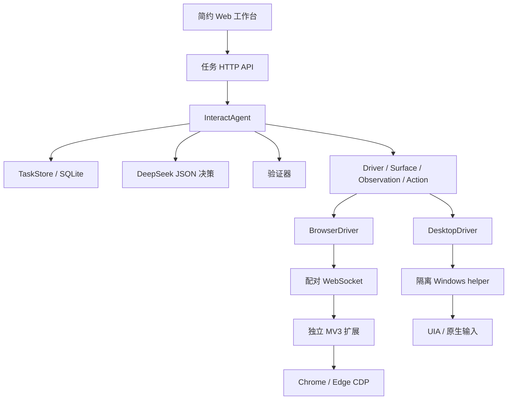

# 设计与参考项目分析

## 产品边界

Dualgent 负责把用户的交互目标落实为真实界面操作，并维护执行状态和证据。模型的输出是受约束的单步交互决策，而不是任意工具调用。当前没有 Shell、文件编辑、插件系统、子 Agent、MCP 编排或通用任务执行接口。

第一阶段的核心问题是：一次输入到底有没有发出、目标身份是否仍然有效、界面是否达到预期，以及中断后能否避免重复产生副作用。

## 参考项目如何取舍

分析的本地源码版本：BrowserAttach `5ec8fd1`、Nosis `9b14c8a`、Windows-MCP `7fd39b4`。

| 来源 | 参考的实现与设计 | 在 Dualgent 中的取舍 |
| --- | --- | --- |
| [BrowserAttach](https://github.com/EvannZhongg/BrowserAttach) 的 hub、connection、controller | 本机配对、profile 身份、标签发现与接管、串行执行、断线清理 | 自有 WebSocket 协议和扩展；任务 ID 作为 owner；不导入 Hub 或 MCP |
| BrowserAttach 的 observation、snapshot、locator、outcomes | AX 观察、backend node 身份、旧 ref 失效、输入与业务结果分离 | 每次观察生成全新 ref；执行前重查文档 loader、AX role/name 和节点；不引入其完整 frame/session 系统 |
| [Nosis](https://github.com/EvannZhongg/Nosis) 的 agent、loop_policy、session_store | 显式决策循环、操作重复检测、持久化记录、前端只展示结构化事件 | 重写为交互专用循环；SQLite 事务提交 intent 与状态；保留单一执行通道，不依赖通用 Runtime |
| Nosis 的 GUI / Bridge 分层 | 前端不持有执行语义，前端重连不改变任务状态 | HTTP 工作台与执行循环分开；浏览器可刷新，服务继续执行；不照搬多前端 Bridge 装配体系 |
| [Windows-MCP](https://github.com/CursorTouch/Windows-MCP) 的 tree、uia、input | UIA 语义观察、RuntimeId、可操作控件、原生输入边界 | 使用独立的 uiautomation 依赖实现精简适配器；不复用 MCP、遥测、Shell、文件系统和整个桌面服务 |

这些项目是设计和源码参照，不是运行依赖。当前实现没有复制它们的整个模块或包，也没有通过路径、子模块、子进程入口或远程服务调用它们。

## 依赖方向



- `contracts.py` 定义环境、元素、观察、动作、回执、检查条件和决策，没有 HTTP、操作系统或模型 SDK 依赖。
- `agent.py` 独占观察、决策、派发、验证与终止语义。前端、模型和驱动都不能直接把任务改为完成。
- `verification.py` 用新的环境事实计算条件，不接收模型给出的 `passed`。
- `store.py` 在事务中保存状态和追加事件，先于外部输入提交 intent；不保存运行时驱动对象。
- `model.py` 只处理结构化决策请求、响应校验和用量；环境与任务控制不进入模型适配器。
- `drivers/` 只实现发现、接管、观察、操作和释放；不维护任务计划或判断业务完成。
- `server.py` 负责装配、认证与 UI 协议；`web/` 只采集输入和展示事件。

没有为了兼容参考项目而引入的接口、配置转换器或旧数据迁移层。

## 统一交互契约

| 类型 | 关键语义 |
| --- | --- |
| `Surface` | 唯一 ID、web/desktop、标题、应用、可用动作；网页还含 URL |
| `Observation` | 观察 ID、当前环境身份、文本、可操作元素、是否截断 |
| `Element` | 当前观察内的 ref、role、name、value、enabled |
| `Action` | `click(ref)`、`fill(ref,text)`、`press(ref,key)`、`scroll(ref,delta)`、`navigate(url)` |
| `Receipt` | `dispatched` 表示输入已派发；`rejected` 表示输入未派发；`unknown` 表示不能排除已产生影响 |
| `Check` | 文本/标题/URL 的字面子串，或元素精确 role/name/可选 value；支持存在或不存在 |
| `Decision` | `act`、`observe`、`finish`、`ask`，包含简短说明、计划和结构化检查 |

每个驱动提供同样的五个异步方法：`discover`、`acquire`、`observe`、`act`、`release`。未支持的动作不会出现在 `Surface.actions`，核心也会在派发前检查能力。

浏览器扩展拥有 tab/debugger lease 和节点身份；Python BrowserDriver 仅做协议翻译。Windows helper 拥有原生控件对象；Python 核心只接触 JSON 观察和不透明 ref。两类句柄不会跨平台混用。

## 执行、持久化与恢复

```text
queued → observing → thinking → acting → verifying → observing ...
                       │                   └─ 最终检查全通过 → succeeded
                       └─ 缺信息/未知结果/预算到达 → needs_attention
needs_attention + 用户补充 → queued（新一轮预算，保留历史）
执行异常 → failed；用户取消 → cancelled
```

`finish` 也进入 verifying，必须采集新观察才能成功。最终检查需要覆盖所有派发过动作的环境。同一轮验证中的条件一起重新计算，不把不同时刻通过的条件累积为成功。缺少元素唯一性或在截断观察中判断“不存在”不能通过验证。

执行意图先提交到 SQLite，再调用驱动。一个完整事件链通常是 `decision → dispatch_intent → receipt → observation → verification`。服务崩溃后，未完成的执行任务被标记为需要检查；不会根据缺失回执补发输入。用户明确继续时重新发现同一环境，可以更新同源 URL 或窗口标题，原始身份和站点授权范围保持不变。浏览器身份使用本次浏览器会话的 ID；重启浏览器后不会按旧 tab 数字自动接管新会话中的标签页。

只有一个后台执行通道，任务按创建顺序处理。这样桌面全局焦点和鼠标不会被两项任务并发抢占。API、浏览器 profile 和 UIA helper 仍可异步通信。SQLite 文件另有进程级单写者锁，防止同一目录启动两个执行者。

重复动作检测将 ref 归一化为控件语义，并纳入当前可观察文本；环境不变时，第三次相同动作在派发前被拒绝。模型历史只带最近 16 条决策/回执/验证等摘要，但完整事件保存在本地；用户补充信息始终携带。

## 驱动中的身份与输入边界

Web：发现时记录精确 URL；接管时再次匹配，然后保存初始 origin。每次操作检查 owner、origin、当前 observation ID、文档 loader 与元素 AX 身份。DOM 只用于定位、几何检查、聚焦和密码保护判断；点击与文本输入走 CDP Input。导航仅允许同源，不隐式接管新标签。新观察、操作或文档变化会使旧 ref 失效。断线先使所有 lease 失效，再排队 detach；detach 失败时不移交控制权。

Windows：窗口 ID 包含 HWND、PID 和进程创建时间；元素 ref 保存 UIA RuntimeId 和语义身份，执行前还校验顶层窗口归属。填值使用 UIA ValuePattern，点击优先 InvokePattern；需要指针输入时检查前台窗口和命中窗口。按键只允许当前契约中的有限键。回执明确记录 UIA 模式还是原生输入，不把 UIA 模式伪装为鼠标或键盘事件。浏览器、终端及锁屏等进程不通过桌面适配器控制。

UIA 调用位于独立 helper 进程，串行收发有限命令；超时后关闭/终止 helper 及其私有子进程，防止迟到输入继续发生。它不是另一个 Agent Runtime，也不接受任意代码。

## macOS 如何加入

Web 能力无需改动核心：MV3 扩展已经按平台选择文本全选修饰键。桌面能力还未实现，当前明确返回 unavailable。

新增 macOS 桌面时，使用 AXUIElement / Accessibility 和必要的原生输入实现同样五个 Driver 方法。平台适配器必须自己负责稳定窗口身份、观察内元素句柄、权限缺失、进程生命周期与输入是否已派发。可选择独立 helper 隔离原生调用；核心、验证器、任务存储和工作台都不应引入 macOS 分支。若增加视觉定位，应先扩展统一观察与坐标契约，再由各驱动声明能力，避免把某个平台的屏幕坐标直接暴露为通用动作。

## 本机边界与尚待完成的约束

服务只监听 loopback；HTTP 检查 Host、Origin 和 Bearer 连接码；扩展握手检查 extension Origin 与连接码。API Key 不发往扩展，页面也不能直接访问本机 API。用户选定的 surface 和 Web origin 由代码约束，页面内容不能扩大范围。

购买、删除、发送消息等敏感操作目前由系统提示词要求先询问用户，尚非独立且可证明的动作审批边界。接入实际无人值守业务前，需要把业务授权范围和冻结动作审批作为独立约束实现。第一阶段验证仅覆盖本地测试工作流，不把它表述为对任意网站或桌面应用的可靠性保证。
