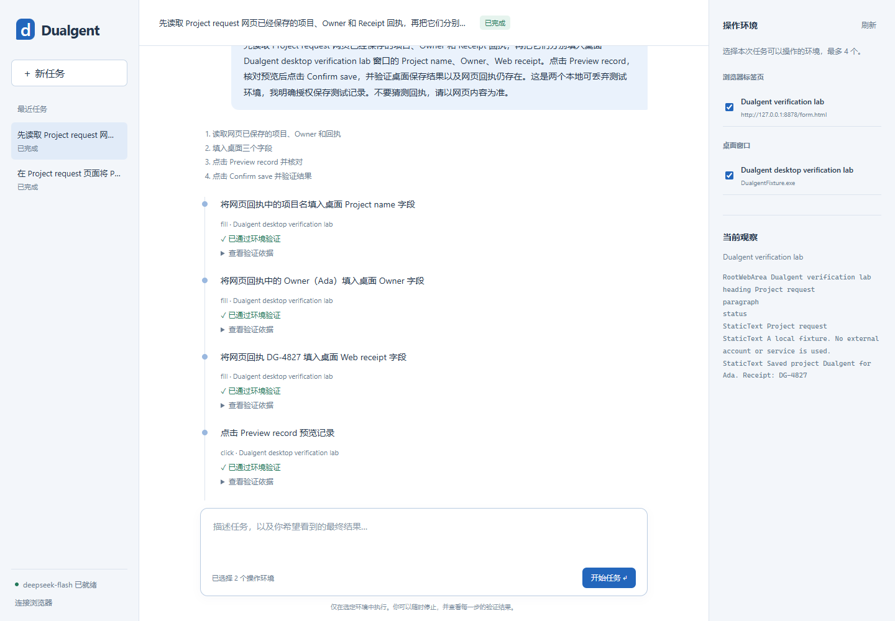

# 第一阶段验证

验收日期：2026-11-01（Asia/Shanghai）。实现版本：0.1.0。

## 验收环境

- Windows 11 build 26200，Python 3.12.4。
- DeepSeek 真实 API，模型 `deepseek-flash`。
- Chromium 156.0.8078.4，独立临时 profile，加载 Dualgent 自有 MV3 扩展。
- 本地 HTTP 表单和临时编译的 WinForms 应用，无第三方账户或业务数据。

没有启动 BrowserAttach、Nosis 或 agent-browser 来执行测试。浏览器输入由独立扩展完成，Windows 输入由独立 UIA helper 完成。Playwright 负责隔离环境准备、配对、只读断言和工作台截图。

## 真实模型任务

| 任务 | 实际操作 | 决策数 | 结果与独立断言 |
| --- | --- | --- | --- |
| Web 表单 | 填写 Project name / Owner，保持 Normal，预览，确认保存 | 5（4 次动作） | succeeded；localStorage 精确等于 Dualgent / Ada / Normal；页面回执 DG-4827 |
| Web → Windows | 从网页读取数据和回执，填入桌面三个字段，预览，确认保存 | 6（5 次动作） | succeeded；桌面输出文件精确为 Dualgent / Ada / DG-4827；桌面保存提示与网页回执共同通过最终验证 |

最终验收运行使用 38,572 个模型 token，包含输入与输出。这是这一轮的用量，不包含之前的联调请求。

Web 任务有一次中间预期不成立：模型点击预览后，错误地期待旧的 `Preview request` 文本仍存在。验证器读取到实际的 `Review request` 和 `Confirm save`，将该次检查记为 false。下一轮模型使用新观察继续确认保存，没有重放预览点击。最终完成检查全部通过。这个案例验证了模型决策、输入回执和环境事实分别记录，系统不会把“已点击”直接当作“已成功”。

可公开的结构化摘要见 [stage-1.json](validation/stage-1.json)。包含任务结果、动作数量、验证轮次、模型用量和最终检查；不包含连接码、API Key、浏览器 profile 或其他窗口内容。完整本机记录保存在执行验证时生成的 `.dualgent/validation-*/report.json` 和 SQLite 数据库。

## 自动化与打包

- **23 项 Python 测试通过**：持久化 intent、最终结果核验、假完成拦截、未知结果不重放、取消、权限范围、继续任务预算、顺序执行、服务重启恢复、单写者锁、精确元素验证、截断观察、HTTP / WebSocket 认证、连接超时隔离、Windows helper 子进程退出、同源恢复边界。
- **6 项扩展测试通过**：ref 失效、文档/元素身份变化、部分派发失败、owner 隔离、detach 失败保留控制权、发现身份与同源导航。
- Ruff 检查、Python 编译和 JavaScript 语法检查通过。
- wheel 构建通过，安装包包含工作台与完整独立扩展。
- 使用官方浏览器扩展检查了由 `dualgent --open` 打开的实际工作台，确认登录、历史任务、环境名称和完成状态正确。

Python 测试中存在上游 Starlette TestClient 关于 httpx 的弃用提示，不影响测试结果。真实模型测试仅手动显式运行，避免自动请求计费或操作维护者桌面。

## 界面

工作台采用任务记录、对话执行轨迹和环境观察三部分；输入区与环境列表独立滚动。下图来自上述真实模型测试，只显示测试环境。

## 阶段结论与限制

已验证一个独立的自主交互闭环：任务持久化 → 模型决策 → Web / Windows 操作 → 新观察 → 验证 → 完成或等待用户。它具备自己的执行状态、恢复规则和证据记录，不只是 BrowserDriver 的封装。

验证范围是本地语义控件任务，尚不能据此推断对任意复杂网站或桌面应用的成功率。macOS 桌面、视觉定位、跨 frame 操作、上传、拖拽及独立的敏感动作审批仍未实现；对应接口边界见 [架构设计](architecture.md)。
